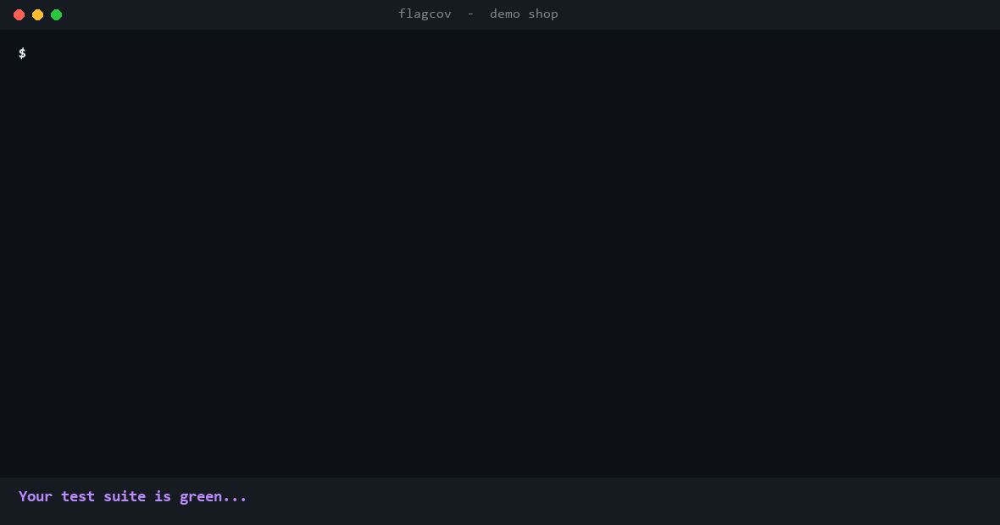
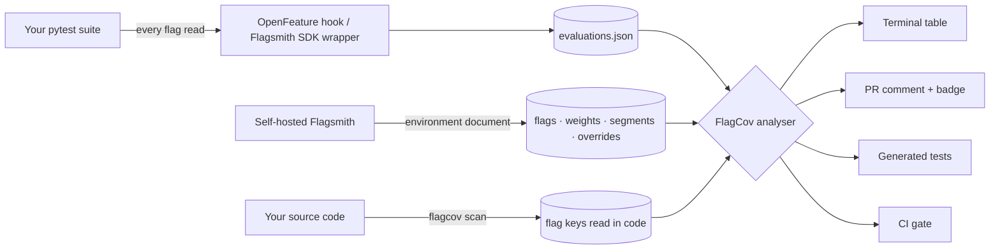

# FlagCov 🚩

**Code coverage for feature flags.**
Your tests are green. But are they testing what Flagsmith is actually serving your users?

[](https://github.com/AryanMashalkar/flagcov/actions/workflows/ci.yml)
[](https://github.com/AryanMashalkar/flagcov/actions/workflows/selfhosted-e2e.yml)
[](https://github.com/AryanMashalkar/flagcov/actions/workflows/dogfood-flagsmith.yml)




*Every line in that GIF is real output from [`examples/demo_shop`](examples/demo_shop). The GIF is regenerated by [`docs/tools/make_gif.py`](docs/tools/make_gif.py).*

Built for **Toggle Wars 2026 · Track 03: Build on Open Source Flagsmith**.

---

## The problem, in one story

On 1 August 2012, Knight Capital deployed new trading code. One of eight servers still had old code on it, and the new release reused a flag that, on that server, switched on a dead feature nobody had tested in years. In 45 minutes the firm lost about **$440 million**.

That's the extreme version of something every team with feature flags lives with:

- We measure **line coverage** obsessively.
- We never measure **flag coverage**.
- And flags change **outside code review**. Someone adds a 10% variant in a dashboard on a Friday, and no pull request, no CI run, no new test ever sees it.

I wanted one number that answers: *of everything Flagsmith can serve in production right now, how much have my tests actually run?*

## What FlagCov does

```bash
pip install "flagcov[flagsmith]"
pytest --flagcov --flagcov-env environment.json --flagcov-scan .
```

```
flag           state     status       who gets it
checkout_flow  classic   tested       60% of prod traffic
checkout_flow  one_page  tested       30% of prod traffic
checkout_flow  express   NOT TESTED   10% of prod traffic
checkout_flow  invoice   NOT TESTED   segment "enterprise" (plan == enterprise)
legacy_promo_banner  on  STALE (no code reads it)

Riskiest flag: checkout_flow (10% of its production traffic hits untested code)
Read in code but missing from Flagsmith: recommendation_v2
```

1. **It records every flag your tests read.** Through an OpenFeature hook (works with any provider) or the native Flagsmith Python SDK. No code changes.
2. **It reads what production actually serves** from Flagsmith's environment document: every flag, every multivariate weight, every segment rule and override, every identity override. The document comes from a file or straight from your **self-hosted** Flagsmith's API.
3. **It compares the two** and tells you, per flag, how much production traffic lands on code your tests have never executed.
4. **It writes the missing tests for you**: a parametrised pytest per untested state, using a `flag_override` fixture that forces any variant, or the "flag turned off" path.
5. **It comments on your pull request** (GitHub Action), focused on the flags that PR touches.

### Things it catches that nothing else does

| Finding | Why it matters |
|---|---|
| **Untested variant, weighted by real traffic** | "express is 10% of checkouts and 0 tests" is a number a team can act on. |
| **Untested segment override**, shown as its rule | Enterprise customers get different code. Did any test run it? |
| **Targeting never verified** | The test forced the "enterprise" value, but no test used traits that actually *match* the rule. FlagCov checks with Flagsmith's own evaluation engine. |
| **Kill switch never tested** | During an incident you turn the flag off. Has that path ever run? |
| **Flag read in code but missing in Flagsmith** | A typo like `recommendation_v2` silently returns the default forever. |
| **Stale flag** | In Flagsmith, but no code reads it any more. Time to clean up. |

## Honest numbers, no made-up maths

- **Variant percentages are exact.** They come straight from `percentage_allocation` in Flagsmith.
- **Segments never get a fake percentage.** Flagsmith knows the rule (`plan == enterprise`), not how many users match it, so FlagCov shows the rule.
- **The headline is the worst case.** "Riskiest flag: 10% of its traffic is untested" is more useful than an average that hides it.

## Quick start

### 1. Run it locally

```bash
pip install "flagcov[flagsmith]"

# Use a saved environment document...
pytest --flagcov --flagcov-env environment.json

# ...or fetch it live from your self-hosted Flagsmith (server-side key)
export FLAGSMITH_API_URL=http://localhost:8000/api/v1/
export FLAGSMITH_SERVER_KEY=ser.xxxxxxxx
pytest --flagcov --flagcov-scan src/

# Fail CI if any flag sends more than 5% of its traffic to untested code
pytest --flagcov --flagcov-fail-untested 5
```

Reports land in `.flagcov/`: `report.md` (the PR comment), `report.json`, `badge.svg`, `evaluations.json` and `test_flagcov_stubs.py` (the generated tests).

### 2. Force a variant in a test

```python
from flagcov import OFF

def test_express_checkout(flag_override):
    flag_override("checkout_flow", "express")   # or OFF for the kill-switch path
    assert checkout(650, "user-1", city="delhi")["eta_days"] > 0
```

### 3. Add it to your pull requests

```yaml
# .github/workflows/flagcov.yml
on: pull_request
permissions: { contents: read, pull-requests: write }
jobs:
  flagcov:
    runs-on: ubuntu-latest
    steps:
      - uses: actions/checkout@v4
        with: { fetch-depth: 0 }
      - uses: actions/setup-python@v5
        with: { python-version: "3.13" }
      - run: pip install -e .
      - uses: AryanMashalkar/flagcov@main
        with:
          api-url: https://flagsmith.example.com/api/v1/
          server-key: ${{ secrets.FLAGSMITH_SERVER_KEY }}
          scan: src
          fail-untested: "5"
```

You get one comment per PR, updated on every push, listing the untested states for the flags that PR touches, plus the tests to paste.

### 4. Try the whole thing with self-hosted Flagsmith

```bash
./examples/selfhosted/run.sh
```

This starts the official open-source Flagsmith image with Docker Compose and seeds a demo project through Flagsmith's REST API: flags, a 60/30/10 multivariate split, an `enterprise` segment with an override, and a server-side key. It then runs the demo shop's tests against the **live** environment document. Change a weight in the dashboard at <http://localhost:8000>, run it again, and watch the report change.

## How Flagsmith is used

FlagCov is built on Flagsmith. Take Flagsmith away and there's nothing to measure.

| Flagsmith piece | What FlagCov does with it |
|---|---|
| **Environment document** (`GET /api/v1/environment-document/`, server-side key) | The source of truth for what production serves: flags, `percentage_allocation`, variant keys, segments, segment overrides, identity overrides. |
| **Self-hosted Flagsmith** | `flagcov fetch` / `--flagcov-api-url` talk to any instance. CI boots the official image and checks the report against it on every push. |
| **Flagsmith's evaluation engine** (`flag-engine`) | Checks whether the traits your tests used actually match each segment rule, the same way Flagsmith would. |
| **OpenFeature + the Flagsmith provider** | The recording hook sits at the OpenFeature API level, so it sees every evaluation, including `variant` and `reason`. |
| **Native Flagsmith Python SDK** | `Flags.is_feature_enabled` / `get_feature_value` are recorded too, with the identity and traits used. |
| **Flagsmith's own codebase** | We run FlagCov on part of Flagsmith's open-source test suite every week. See [Dogfooding](#dogfooding-flagcov-on-flagsmiths-own-tests). |

## Proof it works

- **78 tests**, run on Python 3.10–3.13 on Linux, plus Windows and macOS ([CI](.github/workflows/ci.yml)).
- **Real self-hosted Flagsmith in CI** ([workflow](.github/workflows/selfhosted-e2e.yml)): boots the official Docker image, seeds it through the REST API, fetches the live document, runs the demo with **this repo's own GitHub Action**, and asserts that the report found the untested 10% variant, the segment, the missing flag and the stale flag.
- **A real pull request** with FlagCov's comment on it: see [the demo PR](https://github.com/AryanMashalkar/flagcov/pulls?q=is%3Apr).

## Dogfooding: FlagCov on Flagsmith's own tests

Flagsmith's API evaluates its own flags through OpenFeature and the Flagsmith provider, reading a committed environment document (`api/integrations/flagsmith/data/environment.json`). That's exactly FlagCov's setup, so the [dogfood workflow](.github/workflows/dogfood-flagsmith.yml) checks out Flagsmith, runs the unit tests around flag-reading code with `--flagcov`, and publishes the report.

<!-- DOGFOOD-RESULTS -->

## How it works



Each flag state Flagsmith can serve (the control value, each variant, each segment override, each identity override, and the "turned off" path) is matched against the recorded evaluations. A boolean read only proves the flag was on, so it never counts as covering a multivariate value. Disabled paths are covered when the code falls back to its default.

## Limitations (being upfront)

- **Python and pytest only for now.** JavaScript/TypeScript (Jest/Vitest) is next. The OpenFeature JS SDK has the same hook model, so the analyser and reports carry over.
- **Segment traffic isn't measured.** We show the rule, not a guessed percentage. Flagsmith's analytics could fill this in later.
- **The code scanner is pattern-based.** It finds string-literal flag keys. A key built at runtime (`f"flag_{name}"`) won't be found.
- **Overrides of the same value can be ambiguous.** If a segment serves the same value as the control, testing the value covers both, because it's the same code path.

## Project layout

```
src/flagcov/       analyser, recorder, pytest plugin, reports, scanner, CLI
action.yml         GitHub Action (PR comment, job summary, CI gate)
examples/demo_shop the demo: a tiny shop with a hidden bug behind a 10% variant
examples/selfhosted official Flagsmith docker-compose + REST seeding script
docs/              demo GIF, video script, GIF generator
tests/             78 tests (unit, pytester end-to-end, xdist, live HTTP)
```

## Contributing

```bash
python -m venv .venv && . .venv/bin/activate
pip install -e ".[dev]"
pytest
```

Issues and PRs welcome, especially for JS/TS support.

MIT licensed.
